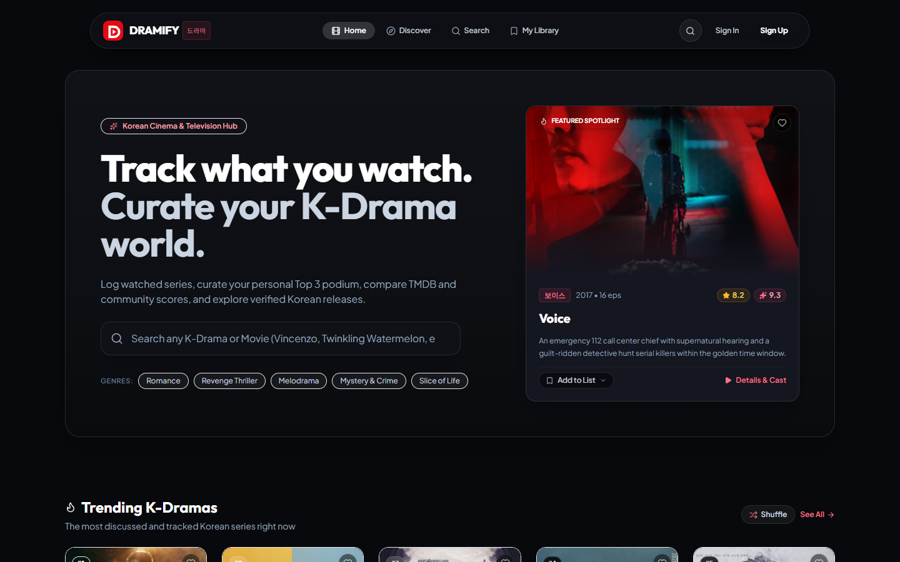
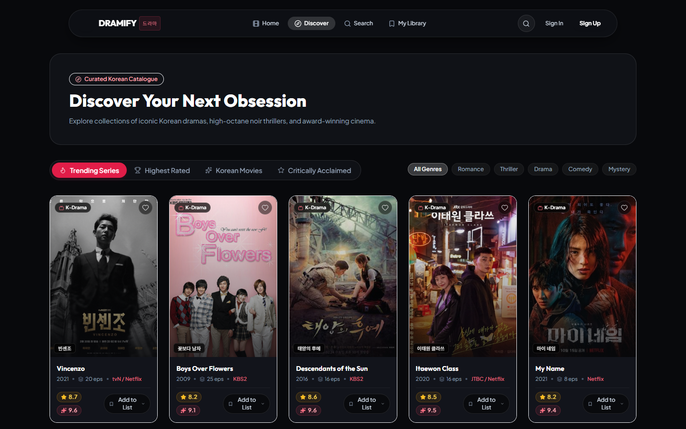

# Dramify (드라마)

**A social tracking and discovery platform for Korean drama and cinema enthusiasts.**

[Features](#features) • [Tech Stack](#tech-stack) • [Getting Started](#getting-started) • [API & Architecture](#api--architecture) • [License](#license)

---

## Overview

Dramify is a web platform designed for Hallyu and Korean cinema fans. It allows users to track series and movies, maintain a personalized watchlist, rate titles with community reviews, and curate personal Top 3 podiums.

The platform connects to **TMDB (The Movie Database)** with strict regional filters to deliver real-time autocomplete search, comprehensive Korean drama/movie metadata, cast listings, and posters.

---

## Features

- **Live Autocomplete Search:** Instant as-you-type search powered by TMDB with strict South Korean origin filtering (`ko` / `KR`).
- **Dynamic Catalog & Auto-Ingest:** Any Korean drama or film searched is pulled with full metadata (cast, episode counts, release dates, and backdrops).
- **Personal Library & Watch Status:** Track titles across *Watched*, *Watching*, and *Plan to Watch*.
- **Top 3 Showcase:** Curate your top 3 favorite K-Dramas and K-Movies on your public profile.
- **Dual Ratings:** Compare official TMDB critic averages alongside genuine Dramify community member reviews.
- **User Authentication:** JWT-based authentication with bcrypt password hashing and customizable profile avatars.

---

## 🖼️ Application Preview

### Home & Spotlight

### Discovery Feed

---

## Tech Stack

### Frontend
- **Framework:** React 19 + TypeScript + Vite
- **Styling:** Tailwind CSS
- **Routing:** React Router v7
- **Icons:** Lucide React

### Backend & Database
- **Runtime:** Node.js + Express (TypeScript)
- **Database:** MongoDB Atlas via Mongoose
- **Auth:** JSON Web Tokens (JWT) + bcryptjs
- **External API:** TMDB (The Movie Database) v3 API

---

## Attribution

This product uses the TMDB API but is not endorsed or certified by TMDB.

---

## License

This project is licensed under the [MIT License](LICENSE).
